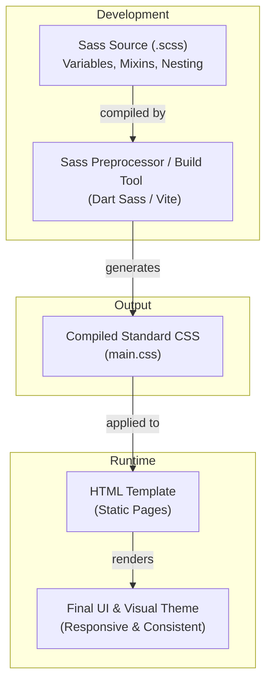
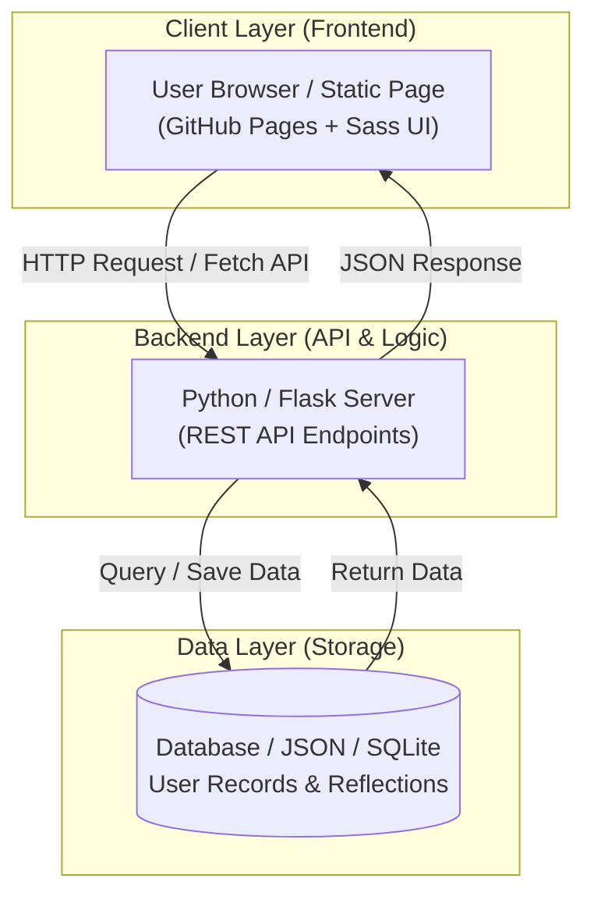
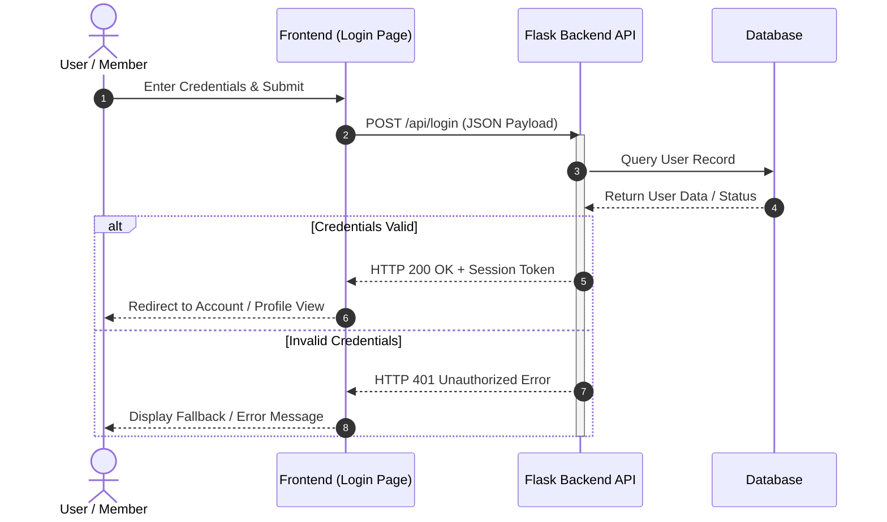
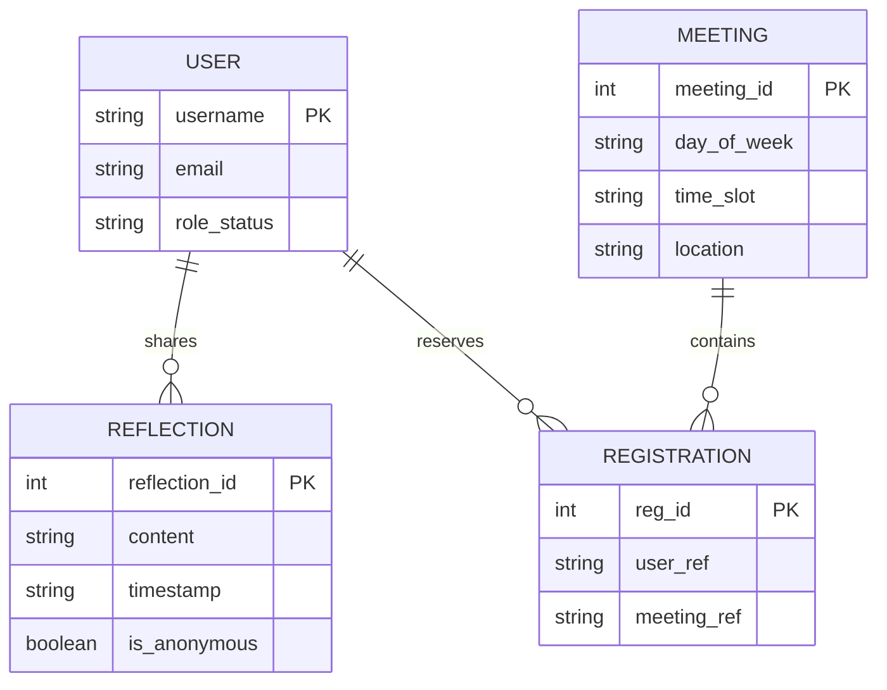
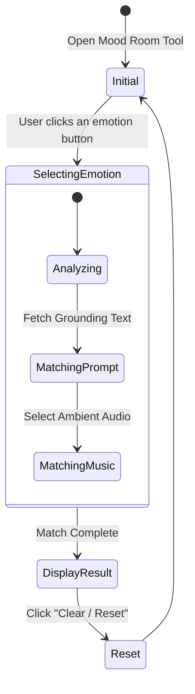
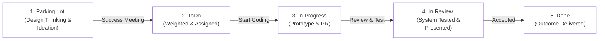

This page brings together diagrams for styling, application architecture, authentication, data, interactive features, and project workflow. Each diagram is a conceptual example; the specific components shown may vary from one project to another.

## 1. Sass to Browser

Sass makes styles easier to organize with features such as variables, mixins, and nested rules. A Sass processor compiles these source files into regular CSS, which the browser applies to HTML to display the finished page.

## 2. Client-Server Architecture

This diagram shows a common three-layer web application. The browser sends requests to a backend API, the backend reads or writes data in a storage layer, and then returns a response. A static site such as GitHub Pages can host the frontend, but it needs a separately hosted backend service to handle API requests.

## 3. Login Request Sequence

This sequence follows a typical login attempt from the user interface to a backend and database. The interface submits credentials, the backend checks the user record, and the result determines whether the user sees the protected area or an error. It illustrates the request-and-response order rather than prescribing a specific authentication implementation.

## 4. Data Relationships

This entity-relationship diagram sketches one possible data model for users, meetings, reflections, and registrations. A primary key (PK) uniquely identifies a record. The relationship lines show that a user may share multiple reflections and make multiple registrations, while a meeting may have multiple registrations.

## 5. Mood Room Interaction States

This state diagram describes the main steps in a mood-selection feature: the user opens the tool, chooses an emotion, and the interface gathers grounding text and matching music before displaying a result. The reset action returns the feature to its starting state so the user can begin again.

## 6. Project Workflow

This workflow represents how an idea can move through a team project: it begins in the parking lot, is prioritized and assigned, then moves through implementation and review before completion. Each transition represents a team decision or handoff, helping clarify what should happen next.

